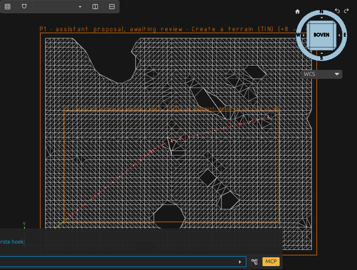
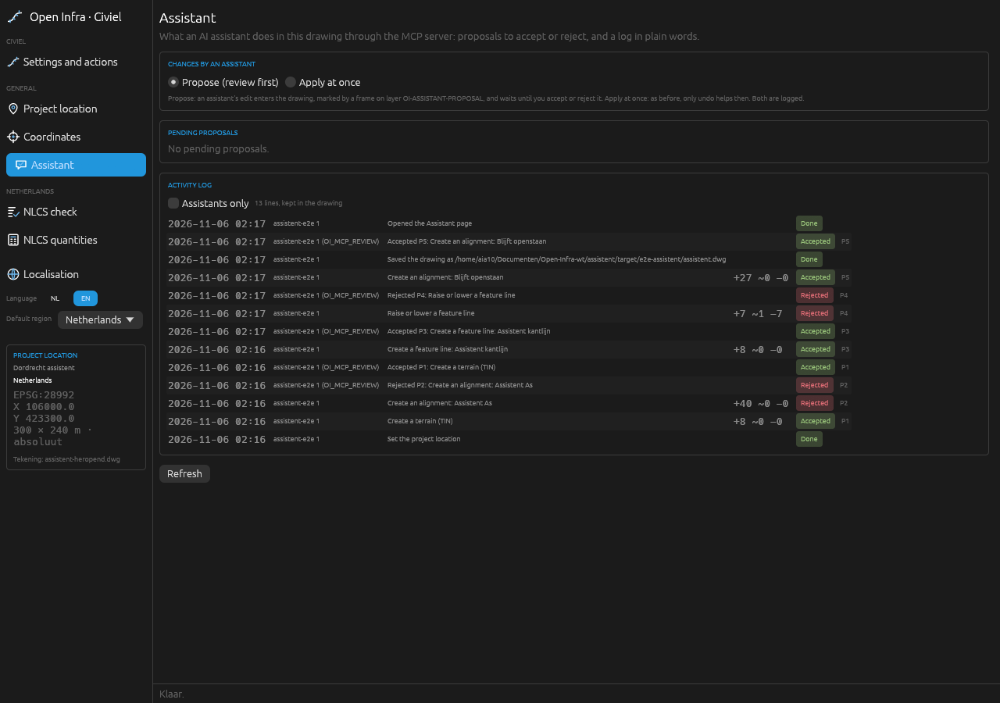

# AI assistant changes as proposals, and the activity log

An AI assistant drives Open Infra through the MCP server (`mcp/open_infra_mcp.py`). Until now every command it ran changed the drawing at once: undo was the only safety net, and afterwards nobody could see what the assistant had done. Now:

- every MCP tool has a **class**: read, edit, export or save;
- in **propose mode** (the default) an edit still runs, but its change becomes a **pending proposal** that you accept or reject;
- an **activity log** in the drawing says in plain words what assistants did and what you decided.



## Tool classes

| Class | Meaning | MCP annotations | Examples |
|---|---|---|---|
| read | looks, changes nothing | `readOnlyHint: true` | `oi_status`, `infra_catalog`, `gis_services`, `civ_station`, `oi_view`, `oi_capture`, `proposals_list`, `activity_log` |
| edit | changes the drawing; in propose mode a proposal | `readOnlyHint: false`, `destructiveHint` true for tools that modify or remove entities | `civ_tin`, `civ_alignment`, `civ_corridor`, `gis_import`, `civ_feature_line_edit`, `oi_command` |
| export | writes a file from the drawing, leaves the drawing as it is | `readOnlyHint: false`, `destructiveHint: false`, `idempotentHint: true` | `ifc_export`, `civ_landxml_export`, `quantities`, `bgt_mutation`, `civ_points_export` |
| save | writes or switches the drawing file | `destructiveHint: true` | `oi_save`, `oi_open`, `infra_opslaan` |

Each tool in `tools/list` carries the four annotations of the MCP specification (`readOnlyHint`, `destructiveHint`, `idempotentHint`, `openWorldHint`; [MCP 2025-06-18, Tools](https://modelcontextprotocol.io/specification/2025-06-18/server/tools)) and its class in `_meta["org.openaec/class"]` ([`_meta` and its key prefixes](https://modelcontextprotocol.io/specification/2025-06-18/basic#meta)). `openWorldHint` is true for tools that fetch data from the internet (AHN, PDOK, 3D BAG, BRO, map servers). A tool that is sometimes an edit and sometimes not (`nlcs_check` with `repair`, `civ_assemblies` with `at`) has the class of its strongest effect.

The classes live in one table in the server (`CLASS`). `tests/test_mcp_assistant.py` fails when a tool has no class, so a new tool cannot slip through.

## Propose or apply

The setting is `assistant` in `<config>/OpenCADStudio/open-infra/settings.json`, and on the **Assistant** page of the workbench window:

```json
{ "assistant": "propose" }
```

- **`propose`** (the default): an edit runs and its result is in the drawing, but it stays a pending proposal until you accept or reject it.
- **`apply`**: as before. The change is a done fact; undo is the safety net. It is still logged.

The person who starts the MCP server can override the file with `OI_ASSISTANT=propose|apply` in the server's environment. An assistant cannot change the setting: no tool writes it.

**Why propose is the default.** An assistant works fast and makes plausible mistakes: a wrong axis, a terrain over the wrong area, a feature line raised on the wrong side. In propose mode such a mistake costs one click on *Reject*, also after you made other edits since. Undo would take your own edits with it, or would not reach the assistant's step at all. A proposal costs you nothing when the change is right: the entities are already in the drawing and later steps build on them. So review is on unless you turn it off, for example for a batch run you trust (`tests/e2e/mcp_model.py` runs in apply mode).

## What a proposal is

When an assistant's edit answers, the plugin records:

- the **handles it added**;
- the **entities it modified or removed**, as they were before (all of them, with their handles, layers, geometry and object data), to restore them;
- what it changed in the **object index** (`OPENINFRA/INDEX`);
- the **command and its arguments**, the tool and the client (the `clientInfo` name and version from the MCP `initialize`);
- a **plain-language description**: the command in words ("Create an alignment: Rondweg Zuid") and the command's own answer;
- a **fingerprint** of the proposed entities (see [Stale proposals](#stale-proposals)).

How it works: the MCP server writes a small request file beside the command's answer (`<config>/OpenCADStudio/open-infra/api/<id>.request.json`: client, tool, class, mode, arguments) before it sends the command with `ID=<id>`. The plugin reads it in `dispatch` and records what the command does where every write goes through: `bridge::add_entities_handles` (and so `Out::write_handles`), `bridge::remove_entities`, `bridge::update_entities` (`UpdateEntitiesTransaction`), `bridge::register_object_data` and the infra library's own writes. Before an entity is modified or removed, its state is read by handle (`GetEntitiesBatch`). When the command answers (`civiel::api::write`), the proposal is stored, and only then is the answer written for the MCP server.

### How you see it

The proposed entities stay on their own NLCS layers. Around them comes a **frame with a label** on the layer `OI-ASSISTANT-PROPOSAL`: "P2 · assistant proposal, awaiting review · Create an alignment: Assistent As (+14 ~0 −0)". *Zoom to* on the Assistant page selects the entities and zooms to the frame. They are not selected after the command itself: many commands act on the selection when they get no handle, so a selection left behind would steer the assistant's next step.

We chose the frame over the two other options:

- **A preview layer** (the proposed entities on a marked layer until accepted) would break the next step. Open Infra finds its objects by layer and object data: contours look for the terrain on OG-TRIANGULATIE, a corridor for its axis on AM-AS. A TIN on a preview layer is invisible to them. Accepting would also rewrite every entity (a large terrain or 3D BAG import is thousands), and a crash halfway would leave a mix.
- **Only selecting or highlighting** the new entities is lost with your next click, never survives saving the drawing, and would change what the next selection-based command works on.

The frame is robust: it is two ordinary entities, it survives saving and reopening, it never touches the proposal's own entities, and accept just removes it. Delete it by hand and nothing breaks.

### Accept, reject, dismiss

- **Accept**: the change stays; the frame, the label and the record go.
- **Reject**: what was added is removed, and what was modified or removed comes back from the stored state, **with its own handles** (the host keeps a free handle it is given), so the object index, links between objects and labels that follow their source keep working. What the command changed in Open Infra's object index (`OPENINFRA/INDEX`: which entities are the terrain, an axis, the labels of a feature line) is undone too, key by key, so index entries you or later commands added stay. It does not use the host's undo: edits you made in between, elsewhere in the drawing, stay. A reject is one undo step.
- **Dismiss**: for a stale proposal (below), or one whose previous state was not kept: the drawing stays as it is, the record goes, and the log says *dismissed* instead of *accepted*.

### Stale proposals

The fingerprint is a 64-bit FNV-1a hash ([Fowler–Noll–Vo](https://datatracker.ietf.org/doc/html/draft-eastlake-fnv)) over what each added or modified entity *is*: its kind, layer, colour, linetype, geometry (coordinates on a grid of a millionth of a drawing unit) and Open Infra's object data. It leaves out what only says where the entity sits in the file (handles, owners, reactors, DWG round-trip fields), so saving and reopening the drawing does not change it; a unit test checks that with a DWG written and read back by the host's own codec.

When the fingerprint no longer matches (you moved, edited or deleted one of the proposed entities), the proposal is **stale**. A stale proposal can only be accepted or dismissed: rejecting it would remove or overwrite your edit.

Proposals can build on each other. When a later proposal changed an entity of an earlier one (for example P4 raised a feature line that P3 drew), P3 is stale while P4 is pending, and the page says "changed by the later proposal P4". Reject P4 first, and P3 is clean again.

### Kept in the drawing

| XRecord | Content |
|---|---|
| `OPENINFRA/PROPOSALS/P<n>` | the proposal (JSON): who, tool, command, arguments, description, handles added, modified and removed, markers, fingerprint, extent |
| `OPENINFRA/PROPOSALS/P<n>-STATE` | the entities as they were before the change: bincode, deflate ([RFC 1951](https://www.rfc-editor.org/rfc/rfc1951)), base64 ([RFC 4648](https://www.rfc-editor.org/rfc/rfc4648)), in pieces of 2000 characters |
| `OPENINFRA/PROPOSALS/COUNTER` | the last proposal number given, so a number is never used twice in a drawing |
| `OPENINFRA/ACTIVITY` | the activity log (JSON), the newest 500 lines |

They are DWG XRecords, so proposals and the log survive saving and reopening (checked by the e2e test). A stored state above 16 million characters is not kept: such a proposal can be accepted or dismissed, not rejected. The 16 million and the 500 lines are our own limits, chosen to keep the drawing small; they are not taken from a standard.

## The activity log

Each line has the time (with the local offset), the client name from the MCP `initialize` (`clientInfo`), the tool, a short description, the number of entities added, modified and removed, and the state:

| State | Meaning |
|---|---|
| Awaiting review | a pending proposal |
| Accepted / Rejected / Dismissed | the proposal after your review (the assistant's own line changes, and your review gets a line of its own) |
| Applied | changed the drawing at once (apply mode) |
| Done | finished without changing entities: an export, a save, the project location |
| Failed | the command reported an error and changed nothing |

Edits, exports and saves are logged; reads are not (they would drown the rest). Your accepts, rejects and dismissals are logged with *user* as who. A save through `oi_save` notes itself before it saves, so the saved file holds that line too.

## The Assistant page



Open it from **Civiel → Output and 3D → Settings → Assistant**, **GIS → Output → Assistant**, the *Assistant* item in the window's navigation, or `CIV_ASSISTENT` / `GIS_ASSISTENT`. It shows:

- the mode: *Propose (review first)* or *Apply at once*;
- the pending proposals, each with *Accept*, *Reject*, *Zoom to* (selects the entities and zooms to the frame) and, when it is stale, *Dismiss*;
- the activity log, newest first, optionally only the assistants' lines.

## Commands

For scripts (`ID=<name>` writes the answer to `<config>/OpenCADStudio/open-infra/api/<name>.json`):

| Command | Does |
|---|---|
| `CIV_ASSISTENT` (`CIV_ASSISTANT`, `GIS_ASSISTENT`) | opens the Assistant page |
| `CIV_VOORSTELLEN` (`CIV_PROPOSALS`) | the pending proposals with their status (`proposals` in the answer) |
| `CIV_VOORSTEL_ACCEPTEREN VOORSTEL=P3` (`CIV_PROPOSAL_ACCEPT`) | accept |
| `CIV_VOORSTEL_AFWIJZEN VOORSTEL=P3` (`CIV_PROPOSAL_REJECT`) | reject |
| `CIV_VOORSTEL_VERVALLEN VOORSTEL=P3` (`CIV_PROPOSAL_DISMISS`) | dismiss |
| `CIV_ACTIVITEIT [MAX=50]` (`CIV_ACTIVITY_LOG`) | the activity log (`entries`, newest first) |
| `CIV_ACTIVITEIT_NOTEER TEKST=…` (`CIV_ACTIVITY_NOTE`) | a line of your own in the log |

## MCP tools

| Tool | Class | Does |
|---|---|---|
| `activity_log` | read | the log, newest first (`max`, default 50) |
| `proposals_list` | read | the pending proposals: id, tool, description, handles, stale, restorable |
| `proposal_accept` | edit | accept a proposal by id |
| `proposal_reject` | edit | reject a proposal by id |

`proposal_accept` and `proposal_reject` exist for scripted tests. **An assistant must not accept its own proposals**, so both are refused unless the person who starts the server sets `OI_MCP_REVIEW=1` in its environment; the e2e test does, playing the user. The guard has three layers:

1. the two tools refuse without `OI_MCP_REVIEW=1`;
2. `oi_command` refuses the review commands (`CIV_VOORSTEL_*`, `CIV_PROPOSAL_*`) on the same terms;
3. the plugins refuse a review command that comes with an assistant's ordinary request file; only the server's own review request (written when `OI_MCP_REVIEW=1`) passes, and the log names the client with "(OI_MCP_REVIEW)".

In propose mode `oi_command` runs Open Infra commands (`GIS_`, `CIV_`) and view commands only (`ZOOM`, `PAN`, `VIEW`, `VSCURRENT`, `REGEN`, …): another host command changes the drawing outside Open Infra's writes, so it could not be kept as a proposal. In apply mode it runs any command, as before.

An edit's answer tells the assistant: "Proposal P3 is waiting for the user's review (Assistant page): +12 ~0 -0 entities. The change is in the drawing; later steps can use it." `structuredContent.proposal` has the id and the handles.

## Tests

- `tests/test_mcp_assistant.py`: every tool has a class and the annotations follow it; a tool without a class is caught; the request file in propose and apply mode, with the client name; reads send none; saves note themselves; the review guard; `oi_command` in propose mode.
- Rust unit tests (`src/assistant/`): the capture's bookkeeping (added then removed, first state kept), the restore plan (removed entities back with their handles, a deleted modified entity back, a taken handle refused, incomplete state refused), the fingerprint (handles ignored, edits seen, a DWG round trip), the stored state's round trip, stale detection and which later proposal caused it, the log's cap and state updates.
- `tests/e2e/assistent_e2e.py`, through the MCP server against Open CAD Studio v2026.44: a TIN and an alignment proposed, the alignment rejected (gone, the TIN stays), the TIN accepted; a feature line raised (modified, labels removed and added) and rejected (the line and its old labels back with their handles); the log; a proposal and the log after saving and reopening; a stale proposal; captures.

## Known limits

- **One assistant command at a time.** Writes are attributed to the assistant's command that is running. If you start another Open Infra command (ribbon or window) while an assistant's command runs, its writes join that proposal. The MCP server sends one command at a time and waits for each answer.
- **Entities and the object index only.** Other changes are applied at once and logged, not proposed: the project location, layer styles (`nlcs_check` with `repair` restyles layers), new layers, linetypes, block definitions and sheet layouts. A rejected `CIV_BLADEN` would leave its layouts.
- **Host commands** an assistant runs through `oi_command` in apply mode are not recorded.
- **Stored state** is the codec's binary form; a proposal made with one Open Infra version can be rejected after an update only when the codec's entity types did not change. Otherwise it is accepted or dismissed.
- **Two plugins, one drawing.** The GIS and Civiel plugins run in separate processes and both write the log; a review in one window at the very moment the other plugin finishes an assistant's command could lose one log line.
- **Undo** after an assistant's command undoes the proposal's bookkeeping (frame and records) first, the change itself in the next step. A proposal whose entities were undone is stale.
