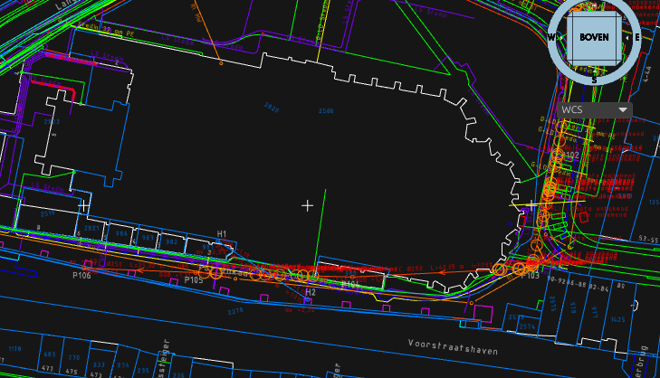
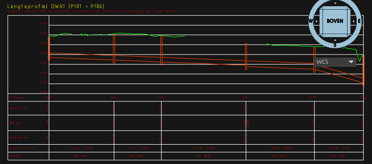

# Sewer design (Riolering)

The Civiel tab's group **Riolering** (Sewers) designs free-flow sewer networks for Dutch practice: manholes and pipes from a polyline, invert levels (BOB, *binnenonderkant buis*) computed from the minimum cover and slope over the ground, NLCS layers and labels, a length profile, checks, and exchange through GWSW-OroX, CSV and IFC.

The design works anywhere a TIN or a height source is available. Three parts lean on Dutch data and say so below: the GWSW import and takeover (Dutch municipal sewer data), the KLIC crossing check (Dutch cable and pipe deliveries) and the design values (Dutch guidance).

## Commands

All commands take `KEY=value` arguments and `ID=<name>` for a JSON result in `<config>/OpenCADStudio/open-infra/api/<name>.json`. Coordinates are project coordinates (RD in the Netherlands). `CIV_RIOOL_HELP` lists the arguments.

| Command | Ribbon | What it does |
|---|---|---|
| `CIV_RIOOL` | Riool ontwerpen (Design sewer) | A run of manholes and pipes, from a polyline (`LIJN=<handle>` or the selection), points (`PUNTEN=x,y;x,y;…`) or picked points (the ribbon button without a selection: upstream first, Enter ends). |
| `CIV_RIOOL_BIJWERKEN` | Bijwerken (Update) | Reads the network back from the drawing, applies edits and recomputes it. |
| `CIV_RIOOL_PROFIEL` | Lengteprofiel (Length profile) | The length profile of a run. |
| `CIV_RIOOL_TOETS` | Toetsen (Check) | Cover, slope, manhole spacing, capacity and velocity, crossings with KLIC and with other sewers. |
| `CIV_RIOOL_EXPORT` | Exporteren (Export) | GWSW-OroX (`FORMAAT=GWSW`, the default) or two CSV tables (`FORMAAT=CSV`). |
| `CIV_RIOOL_IMPORT <file.orox.ttl>` | GWSW-bestand (GWSW file), Dutch modules only | Reads a GWSW-OroX file and draws it the way `GIS_Q_GWSW` draws the PDOK service. |
| `CIV_RIOOL_GWSW` | GWSW overnemen (Take over GWSW), Dutch modules only | Turns GWSW pipes and manholes in the drawing into an editable network. |

### `CIV_RIOOL` arguments

| Argument | Meaning | Default |
|---|---|---|
| `STELSEL=` | `DWA` (foul), `HWA` (storm), `GWA` (combined), `ITR` (infiltration) | `DWA` |
| `DIAMETER=` | nominal size in mm: the outside diameter for plastics (PVC 315), the inside for concrete and vitrified clay (beton 300) | DWA 250, others 315 |
| `MATERIAAL=` | `beton`, `PVC`, `PP`, `PE`, `gres` | PVC up to 630, concrete above |
| `DEKKING=` | minimum cover in m, from ground level to the outside top of the pipe (the wall included) | 0.80 |
| `VERHANG=` | minimum slope: `1:250`, in per mille (`4` = 4 ‰) or as a fraction (`0,004`) | 1 : DN |
| `BOB=` | invert level at the first manhole (m NAP), or `AUTO` | automatic |
| `PUT=` | inner manhole size in mm: `1000` round, `800x1000` rectangular | by pipe size |
| `PUTNR=` | first manhole number with its prefix: `P101` → P101, P102 …; `DWA-008` keeps the zeros | `P<n>01` |
| `NAAM=` | network name | `Riool <n>` (`Sewer <n>`) |
| `OMKEREN=ja` | the flow runs against the polyline's direction | no |
| `MAAIVELD=` | ground source: `AUTO` (existing TIN, else AHN or the worldwide terrain), `ONTWERP` (design TIN first), `AHN` | `AUTO` |

`STATUS=` sets the NLCS drawing status; a design defaults to **N** (new work). `LABELS=nee` leaves out the labels.

A run whose last (or first) point lies in a manhole of another network joins that network: the manhole is reused and only the new pipes are computed. This is how an existing network, taken over from GWSW, is extended.

### `CIV_RIOOL_BIJWERKEN`

Without arguments it picks up what was changed in the drawing:
- a manhole moved (its circle), or a pipe end dragged: the manhole follows;
- a manhole deleted with one pipe in and one out: the two pipes become one; otherwise the manhole comes back;
- a pipe deleted: the network loses it;
- edited object data on a pipe or manhole (diameter, material, levels).

Edits by argument (`RIOOL=<name>` when the drawing holds several networks):
- one manhole, `PUTNR=P103`: `BOB=` (fixed outgoing invert, `AUTO` frees it), `MAAIVELD=` (fixed ground level, `AUTO` frees it), `PUT=` (size);
- one pipe, `LEIDING=P103-P104` (or its sequence number): `DIAMETER=`, `MATERIAAL=`, `VERHANG=`, `DEKKING=`, `STELSEL=`;
- without `PUTNR=` or `LEIDING=`: the pipe properties for every design pipe of the network, `PUT=` for every manhole;
- `INVOEGEN=x,y`: a new manhole on the nearest pipe, which is split;
- `REFERENTIE=AUTO|ONTWERP|AHN`: the ground source.

The levels are computed again, the network is redrawn, its length profile is redrawn in its place, and old check markers are removed (run the check again). The removal and the new drawing are two undo steps.

### `CIV_RIOOL_PROFIEL`

`RIOOL=`, `VAN=` and `NAAR=` (manhole numbers; default: the longest run through the network), `PLAATS=x,y` (lower-left corner of the graph). Without `PLAATS=` the profile goes in the row of views below the project, or where the network's previous profile was. `STAP=` (ground sample distance) and `OVERHOGING=` (vertical exaggeration, default 10) are the general settings.

The profile draws, after the alignment's length profile:
- the ground line (`GW-MAAIVELD`), broken where the source has no height;
- each pipe as a double line, invert and inside crown, on its pipe layer;
- each manhole as a shaft at its true width, from its bottom to the ground;
- a height grid with NAP labels;
- a band (`AL-PROFIELBALK`) with the manhole numbers, ground levels, BOB in and out (two values where they differ), distance, length and slope, size and material.

### `CIV_RIOOL_TOETS`

`RIOOL=` (default: all networks), and the design flow:
- `Q=` in l/s at the outlet; or
- `OPPERVLAK=` (connected paved area, m², or ha with `ha`) × `REGEN=` (l/s/ha, default 60); and/or
- `INWONERS=` × 12 l/h (dry weather peak).

The flow is spread over the pipes in proportion to the pipe length upstream of each pipe. Other arguments: `PUTAFSTAND=` (maximum spacing), `VRIJ=` (clearance), `RUWHEID=` (wall roughness in mm for every pipe).

What it checks:

| Check | Severity | How |
|---|---|---|
| Cover | error | ground minus the outside top of the pipe, along the whole pipe, against the pipe's minimum |
| Slope | error | flatter than the pipe's minimum, or adverse |
| Manhole spacing | error | pipe longer than the maximum |
| Capacity | error | design flow above the full-pipe capacity (Prandtl-Colebrook) |
| Velocity | warning | full-pipe velocity below 0.6 m/s (self-cleansing) or above 4 m/s (3 m/s for concrete) |
| KLIC | error or warning | a plan crossing with a cable or pipe of a KLIC delivery (object data `bron=KLIC`, or an NLCS `KL` layer). With a known level the vertical clearance is checked (error below 0.20 m); without one, a warning with the sewer's invert at the crossing. |
| Other sewers | error | a plan crossing with a pipe of another network or an imported GWSW pipe with its BOB; error below 0.15 m clearance, outside to outside |

KLIC is Dutch data. A KLIC delivery (IMKL 2.0) rarely carries depths, and `GIS_KLIC_IMPORT` draws it in plan, so most crossings come out as warnings. A level is taken from a 3D line (a vertex off zero) or from object data `diepte`, `diepte_m`, `diepteTovMaaiveld`, `dekking` (below ground) or `diepte_nap`, `hoogte_nap` (absolute). The same check works on any cable or pipe on an NLCS `KL` layer, Dutch or not.

Results:
- markers in the drawing: a circle with a short text on `OI-RIOOLTOETS` (errors, red) or `OI-RIOOLTOETS-LET-OP` (warnings, orange), with the finding as object data;
- a CSV report beside the drawing, `riooltoets_<name>.csv`;
- with `ID=`, the JSON: findings, the hydraulics per pipe (inner diameter, roughness, slope, full-pipe velocity and capacity, design flow, filling ratio, smallest cover) and every crossing with its clearance.

### `CIV_RIOOL_EXPORT`

`RIOOL=` (default: all networks), `FORMAAT=GWSW|CSV`, `PAD=` (default beside the drawing).

- **GWSW-OroX** (`<name>.orox.ttl`): RDF Turtle on the GWSW ontology of Stichting RIONED, version **1.7** (namespace `http://data.gwsw.nl/1.7/totaal/`), after the official example dataset `GwswDataset__Voorbeeldstelsel_v1.7.orox.ttl` and the handbook *GWSW.orox Opbouw dataset* (apps.gwsw.nl/doc). It holds:
  - one `Vuilwaterstelsel` / `Hemelwaterstelsel` / `GemengdStelsel` / `Infiltratiestelsel` per network and system, with its `rdfs:label`;
  - each manhole as `gwsw:Inspectieput` with `BreedtePut`, `LengtePut`, `DiameterPut` (round), `HoogtePut` (ground to bottom, when 0.5–4 m), `VormPut`, a `Putorientatie` with its `Punt` (GML, RD) and a `Maaiveldorientatie` with the `Maaiveldhoogte`;
  - each pipe as `gwsw:Vuilwaterriool` / `Hemelwaterriool` / `GemengdRiool` / `Infiltratieriool` with `BreedteLeiding` and `HoogteLeiding` (the nominal size), `VormLeiding Rond`, `MateriaalLeiding` (`Beton`, `PVC`, `PE`, `Polypropyleen`, `Gres`), `LengteLeiding`, and a `Leidingorientatie` with its `Lijn` and its `BeginpuntLeiding` / `EindpuntLeiding`, which connect to the manholes' orientations and carry `BobBeginpuntLeiding` / `BobEindpuntLeiding`;
  - for design values, `WijzeVanInwinning Plan_Ontwerp` on the BOB;
  - objects belong to their system through `gwsw:isPartOf`.
  The coordinates are RD (EPSG:28992), with NAP heights; a project in another CRS is transformed to RD.
- **CSV**: `<name>_putten.csv` (manhole, system, X, Y, ground level, size, lowest BOB, depth) and `<name>_leidingen.csv` (pipe, from, to, system, material, nominal, inner diameter, wall, length, BOB from and to, slope, smallest cover, the design rules), with `;` and a decimal comma.

**Reading back.** `CIV_RIOOL_IMPORT` reads an OroX file of any GWSW version (1.5, 1.6, 1.7) into the properties of the PDOK GWSW service (`beheerleiding`, `beheerput`: `naam`, `type`, `stelseltype`, `beginpunt`, `eindpunt`, `bob_beginpunt_leiding`, `bob_eindpunt_leiding`, `breedte_leiding`, `materiaal_leiding`, `maaiveldhoogte`, `breedte_put` …), and draws them through the same function as `GIS_Q_GWSW`. A file exported by `CIV_RIOOL_EXPORT` comes back on the same NLCS objects, with its levels.

**IFC.** The IFC 4.3 export (`CIV_IFC`) writes each pipe as an `IfcPipeSegment` with a hollow tube (`IfcSweptDiskSolid`) at its real height (the axis at BOB + half the inner diameter) and each round manhole as an `IfcDistributionChamberElement` (MANHOLE) with a shaft from its bottom to the ground. The property set `OpenInfra_Sewer` carries `InvertLevelStart`, `InvertLevelEnd`, `NominalDiameter`, `InnerDiameter`, `WallThickness`, `Material`, `Length`, `Slope`, `System`, `FromManhole`, `ToManhole`, and for manholes `ManholeNumber`, `GroundLevel`, `BottomLevel`, `Depth`, `ManholeSize`; all object data also goes along in `OpenInfra_ObjectData`. Imported GWSW pipes and manholes with their levels get the same bodies. Labels are annotations; the flow arrows are symbols.

### `CIV_RIOOL_GWSW` (Dutch data)

Takes the GWSW pipes and manholes in the drawing (the selected ones, else all), drawn by `GIS_Q_GWSW` or `CIV_RIOOL_IMPORT`, over as CIV_RIOOL networks, one per system (`NAAM=` names them):
- pipes are linked to their manholes by `beginpunt` / `eindpunt`, else by the nearest manhole within a metre, else by a new node;
- a pipe that rises from begin to end is turned, so pipes point downstream;
- measured BOB and ground levels are kept as **existing** (`bestaand=ja`, status B): they are never recomputed;
- pipes without a BOB get one by the design rules (reported);
- the GWSW entities and their manhole labels are replaced.

A new run that ends in one of these manholes joins the network. It is computed from its own ground and rules, and warned when it arrives below the invert of the existing outgoing pipe.

## How the invert levels are computed

The network is a graph of manholes and pipes pointing downstream. The design pipes are computed in flow order (each after the pipes that flow into its upstream manhole); existing pipes keep their levels. For each pipe:

1. The ground is sampled every `STAP=` m (default 1 m) along the pipe, and at both manholes. A manhole where the source has no height takes the mean ground in a ring of 0.5–3 m around it, else the nearest sample along its pipes (reported as an estimate).
2. The highest allowed start is the lowest of:
   - the ground at the upstream manhole minus the minimum cover minus the pipe's height (inner diameter plus one wall);
   - the BOB of each pipe flowing in, lowered by the difference in inner diameter when this pipe is larger (crown on crown);
   - a fixed BOB at the manhole (`BOB=`), which overrides and is warned about when it is too shallow or above an incoming pipe.
3. The slope is the minimum slope, or steeper where the ground falls faster: the smallest slope that keeps the minimum cover at every sample. So the pipe stays as shallow as the rules allow; where the ground falls steeply it follows the ground at minimum cover.
4. The end level follows from the slope and the length.

A loop of design pipes is refused.

## Layers, labels and object data

The layers are those the GWSW import (`src/gis/gwsw.rs`) chooses, from the system, material and size, at the drawing status:

| What | NLCS object (element) | Example |
|---|---|---|
| Pipe | `<SYS>_RIOOLLEIDING_<MAT>_<DN>` (G), else `…_<MAT>`, else `<SYS>_RIOOLLEIDING` | `N-XX-RI-DWA_RIOOLLEIDING_PVC_250-G` |
| Manhole, true size | `<SYS>_RIOOLPUT_INSPECTIEPUT` (G) | `N-XX-RI-DWA_RIOOLPUT_INSPECTIEPUT-G` |
| Manhole number | `<SYS>_PUTNUMMER` (T) | `P101` |
| Ground level | `<SYS>_PUTDEKSELNIVEAU` (T) | `mv +2,89` |
| BOB at both pipe ends | `<SYS>_BOB` (T) | `BOB +1,85` |
| Size, material, length, slope | the pipe object (T) | `PVC Ø250  L=33,24 m  i=1:250` |
| Flow direction | `<SYS>_STROMINGSRICHTING` (G) | an arrow halfway |

Every entity of a network carries the object data (XDATA `OPENINFRA`) `riool=<name>` and `rol=put|leiding|label`. Manholes and pipes carry the whole design, so later commands rebuild the network from the drawing alone:
- manhole: `put`, `stelsel`, `x`, `y` (project coordinates), `maaiveld`, `maaiveld_vast`, `bob_vast`, `bob_laagst`, `diepte`, `afmeting`, `vorm`, `type`, `bestaand`, `referentie`;
- pipe: `leiding`, `van`, `naar`, `stelsel`, `type` (GWSW class), `diameter`, `materiaal`, `wanddikte`, `binnendiameter`, `bob_van`, `bob_naar`, `lengte`, `verhang`, `dekking_van`, `dekking_naar`, `dekking_min`, `verhang_min`, `verhang_auto`, `bestaand`.

The networks are also listed in the object index (`OPENINFRA/INDEX`, kind `riool`), and their profiles under `rioolprofiel`.

## Design values and their sources

Each value is cited; a value that could not be checked in its source is marked as an estimate. Municipal requirements often differ from the national guidance: set them with the arguments.

| Value | Used | Source |
|---|---|---|
| Minimum cover | 0.80 m to the outside top of the pipe | Stichting RIONED, *Module Riolering voor het HBO* (v2, 2009), §5.2.1 "Minimale dekking": a minimum cover of 0.8 m applies in the Netherlands (frost, traffic). Municipalities ask more: Rotterdam 1.10 m (*PvE Water – Vrijverval riolering*, 2024, §3.1), Veenendaal 1.10 m (handbook ch. 31, rule 561), Amersfoort 1.35 m. The HBO module advises 1.20–1.40 m at upstream ends for house connections (ch. 6). |
| Minimum slope | i = 1/D, D the nominal size in mm (DN 250 → 1:250) | RIONED HBO module §5.2.1 and §5.3.2: a rule of thumb for about constant bed shear stress. Veenendaal uses 1:200 / 1:400 / 1:800 for DWA by distance from the end (rules 596–600). |
| Default diameter | DWA 250, HWA and GWA 315 (PVC) | RIONED HBO module §5.2.1: 300 mm usual for storm and combined sewers, 250 mm for foul sewers; Veenendaal rules 556–559: HWA 300 inside (concrete) or 315 outside (plastic), DWA 250 outside. |
| Maximum manhole spacing | 70 m up to DN 800, 100 m above | RIONED HBO module ch. 6 (sewer runs); Rotterdam (§3.2) and Veenendaal (rule 572) use 75 m, Amersfoort 80 m. The reason is the reach of cleaning and inspection. |
| Default manhole size | round, inside 800 up to DN 400, 1000 up to 600, 1250 up to 800, 1500 up to 1000, 1750 up to 1250, 2000 above | Rotterdam, *PvE Vrijverval riolering*, tabel 2 (manhole size against the largest pipe; the smaller of its two values per size). Concrete manholes are at least 800 × 800 inside (Amersfoort, Veenendaal rules 640–641). |
| Wall roughness k | PVC, PE 0.4 mm; vitrified clay 0.5 mm; concrete 3.0 mm; PP 0.4 mm (estimate, as PE) | RIONED HBO module tabel 5.5 ("first indication"). Other sources: Wavin *Handboek straatriolering* (2017) k_b 1.5 mm non-plastic, 0.4 / 0.25 mm plastic; DWA-A 110 k_b 0.25–1.50 (seen in a secondary source only). |
| Rain intensity | 60 l/s/ha over the paved area | RIONED HBO module §5.2.2 (90 l/s/ha is sometimes used in sloping areas). Many municipalities now design with *bui 08* (return period 2 years, RIONED kennisbank) and a climate factor (Veenendaal rule 552: +13 %); the tool takes `Q=` for such a flow. |
| Dry weather flow | 12 l/h per inhabitant (peak) | RIONED HBO module §5.2.2. |
| Self-cleansing velocity | 0.60 m/s at full pipe | RIONED HBO module §5.2.1. |
| Maximum velocity | 4 m/s; 3 m/s for concrete | RIONED HBO module §5.2.1 (4 m/s for DWA; 2–3 m/s for concrete carrying sand). |
| Kinematic viscosity | 1.31 × 10⁻⁶ m²/s | water at 10 °C (physical constant). |
| Crossing clearance, sewers | 0.15 m outside to outside | RIONED HBO module ch. 6 (0.10–0.15 m); Veenendaal rule 564 (0.15 m); Amersfoort asks 0.30 m. |
| Crossing clearance, cables and pipes | 0.20 m | De Ronde Venen, *Handboek kabels en leidingen*, art. 2.1.2 (lokaleregelgeving.overheid.nl, CVDR728013). NEN 7171-1 could not be checked (not public). |
| PVC wall (NEN-EN 1401, SN 8) | 160 × 4.7, 200 × 5.9, 250 × 7.3, 315 × 9.2, 400 × 11.7, 500 × 14.6 mm; other sizes OD/34 (estimate) | Wavin SN8 PVC pipe sheet (BENOR, NEN-EN 1401 sizes). |
| Concrete wall (NEN-EN 1916) | 300/55, 400/55, 500/70, 600/85, 700/95, 800/105, 900/110, 1000/125, 1250/154, 1500/187 mm, interpolated; 250/50 (estimate) | Martens, *Maru betonbuizen*, table "Vormgeving en afmetingen" (one manufacturer; others differ by a few mm). |
| PP and PE wall | OD/33 | estimate (not found). |
| Vitrified clay wall | DN/12 + 10 mm | estimate (not found). |

Sources:
- Stichting RIONED, *Module Riolering voor het HBO*, v2, March 2009: <https://www.riool.net/media/cgtfrx5t/module-riolering-voor-het-hbo.pdf>
- Gemeente Rotterdam, *PvE Water – Technische eisen Vrijverval riolering*, 11 October 2024: <https://www.rotterdam.nl/media/2020>
- Gemeente Veenendaal, handbook ch. 31 *Riolering* (13 June 2022): <https://repository.officiele-overheidspublicaties.nl/externebijlagen/exb-2022-43987/currentitem>
- Gemeente Amersfoort, *Ontwerp- en uitvoeringsvoorschriften riolering*: <https://amersfoort.nl/sites/default/files/Ontwerp-%20en%20uitvoeringsvoorschriften%20riolering_1.pdf>
- Gemeente De Ronde Venen, art. 2.1.2: <https://lokaleregelgeving.overheid.nl/CVDR728013/1>
- Wavin, *Handboek straatriolering*, 2017: <https://mediahub.wavin.com/m/4ae4d1aace0917a1/original/Handboek-straatriolering.pdf>; SN8 PVC sheet: <https://mediahub.wavin.com/m/3ad0f874549e81e7/original/SN8-PVC-buis-tuyau-BENOR.pdf>
- Martens, *Maru betonbuizen*: <https://martensgroep.eu/nl/file-download/download/public/9610>
- GWSW 1.7: <https://data.gwsw.nl/>; example dataset <https://apps.gwsw.nl/doc/GwswDataset__Voorbeeldstelsel_v1.7.orox.ttl>; handbook *GWSW.orox Opbouw dataset* <https://apps.gwsw.nl/doc/GWSW.orox%20Opbouw%20dataset.pdf>; PDOK GWSW service <https://api.pdok.nl/rioned/beheer-stedelijk-watersystemen-gwsw/ogc/v1>

The full-pipe velocity is Prandtl-Colebrook (Colebrook-White):

v = −2 log₁₀( k / (3.71 D) + 2.51 ν / (D √(2 g D I)) ) · √(2 g D I),  Q = v · π D² / 4

with D the inner diameter, I the slope, k the wall roughness, ν the kinematic viscosity and g = 9.81 m/s².

## Limits

- One network per name; manholes are inspection manholes (no pumps, overflows or pressure mains).
- A polyline's arcs become straight pipes between the vertices.
- The cover counts from the ground level of the chosen source; AHN has no ground under buildings and water, so a pipe through a building is only checked at the samples that have ground.
- Rectangular manholes get no 3D body in IFC (round ones do).
- KLIC deliveries usually have no depths: their crossings are warnings until a depth is known.
- The GWSW `BreedteLeiding` is written as the nominal size, as municipal GWSW data does (PVC 250 with a wall of 7 mm).
- Updating removes and redraws the network: two undo steps.

## Tests

- `cargo test --lib -- riool gwsw ifc`: the BOB rules (flat ground, falling ground, a bump, crown matching, a fixed BOB, a branch joining existing pipes, a loop refused, paths), Prandtl-Colebrook, the argument parsing and design-value tables, the NLCS objects, the GWSW-OroX round trip (writer and reader, also another GWSW version and layout), and the IFC mapping of a designed sewer.
- `python3 tests/e2e/riolering_e2e.py --port 18812`: in Open CAD Studio, on a copy of `examples/dordrecht-nlcs` with `GIS_SITE RD 104885 425320 200 150 Dordrecht` and AHN as ground: a DWA run of six manholes, its profile, a crossing HWA run, a 3D test cable on a KLIC layer, the check, an update after moving a manhole and enlarging a pipe, the GWSW and CSV export, reading the OroX back into a new drawing, taking it over and extending it with a new run.
