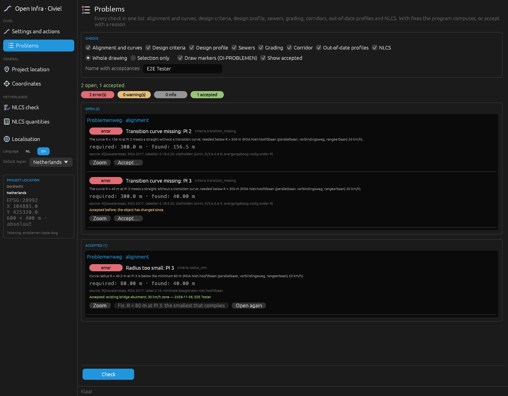

# Design problems: one list of every check, with fixes

Every check of the Civiel tab used to report in its own way: markers of the alignment check, the sewer check's circles and CSV, the grading and corridor messages on the command line, curves that silently came out shorter, the NLCS report. **Design problems** puts them in one list. Each problem says what is required against what is found, which object it is about and where. Where the program can work out a fix, it offers it; each fix is one undo step. A problem you decide to live with can be accepted with a reason; the acceptance is kept in the drawing until the object changes.

- **Ribbon:** Civiel tab, group *Uitvoer en 3D / Output and 3D*, **Problemen / Problems**. It opens the **Problems** page of the workbench window and runs the checks. On the GIS tab the *NLCS* menu has **All problems (design + NLCS)**, which opens the same page in the GIS window.
- **Commands:** `CIV_PROBLEMEN`, `CIV_PROBLEEM_HERSTEL`, `CIV_PROBLEEM_ACCEPTEER`.
- **MCP:** `problems_list`, `problem_fix`, `problem_accept`.

## The checks

| Check (`CONTROLES=`) | Codes | Source of the limits | Fix |
|---|---|---|---|
| `alignment`: curves of an axis by layout | `alignment.curve_overlap`, `alignment.curve_no_fit` | geometry only | the largest radius at either PI that still fits with the other kept, or both scaled down |
| `criteria`: the design criteria of the axis (`CIV_ONTWERPCRITERIA`) | `criteria.radius_min`, `criteria.clothoid_min`, `criteria.clothoid_ratio`, `criteria.transition_missing`, `criteria.grade_max`, `criteria.grade_min`, `criteria.crest_min`, `criteria.sag_min`; `criteria.none` (info) and `criteria.unknown` | the tables of [design criteria](civiel-as-spoor.md#the-tables), each value with its source there | radius: the minimum radius, when it fits between the neighbouring curves; crest and sag: the curve length that gives the minimum radius, when it fits |
| `profile`: vertical curves of a design profile | `profile.curve_no_fit` | geometry only | the asked length when it fits, else the longest that fits, with K and R |
| `sewer`: `CIV_RIOOL_TOETS` | `sewer.changed`, `sewer.cover`, `sewer.slope`, `sewer.manhole_spacing`, `sewer.capacity`, `sewer.velocity`, `sewer.utility_clearance`, `sewer.utility_depth`, `sewer.sewer_clearance` | [sewer design values](civiel-riolering.md) | see below |
| `grading`: plateaus and slopes | `grading.no_daylight` | — | none |
| `corridor` | `corridor.no_design_height`, `corridor.no_daylight`, `corridor.stale` | — | none |
| `products`: length profiles and cross sections out of date | `products.stale` | — | make them again in their place (`CIV_BIJWERKEN`) |
| `nlcs`: the NLCS check | `nlcs.L1` … `nlcs.L7`, `nlcs.E1` … `nlcs.E5` | NLCS 5.02, see the [NLCS check](../README.md#dutch-base-data-to-nlcs) | the NLCS repair: layer colour, lineweight and linetype, or elements ByLayer |

The NLCS check runs by default when the regional profile is the Netherlands; elsewhere add it with `CONTROLES=…;nlcs` or the checkbox on the page. It reads the whole drawing, so it takes longest.

Gradings and corridors made before this version carry no counts of their slope lines and sections; make them again to have them checked.

## `CIV_PROBLEMEN`

```
CIV_PROBLEMEN [ALLES|SELECTIE] [CONTROLES=as;criteria;profiel;riool;grading;corridor;producten;nlcs] [MARKERINGEN=nee] [ID=<name>]
```

- `ALLES` (default) checks the whole drawing, `SELECTIE` only the objects of the selected entities.
- `CONTROLES=` chooses the checks (Dutch or English names: `alignment`/`as`, `profile`/`profiel`, `sewer`/`riool`, `products`/`producten`, `all`/`alles`).
- Markers go on dedicated layers, in place of the markers of the previous run: `OI-PROBLEMEN` (errors, red), `OI-PROBLEMEN-LET-OP` (warnings and info, orange) and `OI-PROBLEMEN-GEACCEPTEERD` (accepted, grey). Each marker is a circle with a short title and object data `probleem`, `probleem_object`, `probleem_status`. The NLCS check leaves these layers out. `MARKERINGEN=nee` draws none.
- From the ribbon (without arguments) it opens the Problems page.

With `ID=` the JSON (`<config>/OpenCADStudio/open-infra/api/<name>.json`) holds `problems` and the counts `open`, `errors`, `warnings`, `info`, `accepted`, the `checks` that ran, `notes` (checks that could not run) and `markers`.

### The problem record

```json
{
  "code": "alignment.curve_overlap",
  "severity": "error",
  "check": "alignment",
  "object": "as:2A7/PI1-PI2",
  "title": {"nl": "Bogen overlappen: PI 1 en PI 2", "en": "Curves overlap: PI 1 and PI 2"},
  "message": {"nl": "De bogen bij PI 1 (R = 300,0 m) en PI 2 …", "en": "The curves at PI 1 (R = 300.0 m) and PI 2 …"},
  "required": {"value": 145.60, "unit": "m"},
  "found": {"value": 169.01, "unit": "m"},
  "about": {"handles": ["2A7"], "kind": "alignment", "name": "Problemenweg"},
  "location": {"x": 104830.2, "y": 425350.1, "station": 263.5},
  "source": "ROA 2017, tabel 5.15",
  "fixes": [
    {"id": "pi1", "label": {"nl": "R = 185,70 m bij PI 1, PI 2 houdt R = 200,0 m", "en": "…"},
     "action": {"kind": "axis_radii", "axis": "2A7", "radii": [0, 185.7, 200, 40, 0]}}
  ],
  "no_fix": null,
  "status": "open",
  "accepted": null,
  "acceptance_outdated": false,
  "fingerprint": "3f2c…",
  "markers": ["2F1", "2F2"]
}
```

- `code` is stable; `object` is `<kind>:<key>[/<part>]`: `as:<handle>/PI<n>` (PIs counted from the start, PI 0), `as:<handle>/PI<n>-PI<n+1>` (the straight between two PIs), `profiel:<handle>/PVI<n>`, `riool:<name>/<pipe>`, `grading:<name>`, `corridor:<name>`, `product:<kind>/<axis handle>`, `laag:<layer>`. Together, `code` and `object` name the problem.
- `required` and `found` come with their unit (`m`, `%`, `‰`, `m/s`, `l/s`; `-` for a count).
- `location` is in project coordinates (m), with the station along the axis where there is one.
- `fixes`: each `action` is one of `axis_radii` (radii in m per PI, 0 at the ends), `curve_lengths` (a curve length of its own per PVI, `null` for the profile's), `sewer_update`, `nlcs_layer`, `nlcs_by_layer`, `update_products`. When the program looked for a fix and found none, `no_fix` says why.

## `CIV_PROBLEEM_HERSTEL`

```
CIV_PROBLEEM_HERSTEL CODE=<code> OBJECT=<object> [FIX=<id>|<n>] [ID=]
```

The object is checked again first, so the fix fits the drawing as it is; then the fix is applied as **one undo step** (one `U` takes it back) and the object is checked once more. `FIX=` takes the fix's id or its number (1 = the first, the default). The JSON holds `problem`, `fix`, `applied`, `solved` (whether the problem is gone) and the problems of the object after the fix. An `OBJECT=` of a handle alone (`OBJECT=2A7`) works when only one problem of that code matches.

## `CIV_PROBLEEM_ACCEPTEER`

```
CIV_PROBLEEM_ACCEPTEER CODE=<code> OBJECT=<object> REDEN="<reason>" [ID=]
```

The acceptance is kept in the drawing, in the XRecord `OPENINFRA/PROBLEMEN` (JSON: `code`, `object`, `fingerprint`, `reason`, `date`, `author`). The author is `author` in `<config>/OpenCADStudio/open-infra/settings.json`, when set (the Problems page has a field for it); otherwise none. The problem then shows as **accepted**, with a grey marker, until the object changes:

- The **fingerprint** hashes (FNV-1a, 64 bit) the code, the object reference, the required and found values and the state of the entities the problem is about: their geometry and object data.
- When the object changes (another radius, a moved PI, an edited profile, a recomputed sewer), the fingerprint differs: the problem is **open** again and marked `acceptance_outdated`, until it is accepted anew.
- A run over the whole drawing drops acceptances whose problem is gone, for the checks that ran.

The Problems page can also open an accepted problem again.

## The Problems page

The page in the workbench window lists the problems by status (open, accepted), then by object, errors first. Per problem: its severity, title, message, required against found, the source of the limit, the acceptance (reason, date, author), and the buttons

- **Zoom**: zooms to the problem's marker (or its object) and selects the object;
- one button per **fix**;
- **Accept…**: type the reason, then *Accept*; *Open again* for an accepted one;

and at the bottom **Check**, which runs the chosen checks again (also after every fix or acceptance). The checkboxes choose the checks, the whole drawing or only the selection, and whether markers are drawn.



## How the fixes are computed

### Curves that do not fit between their PIs

`CIV_AS PI=… R=…` (with `LS=` or `A=`) keeps its layout on the axis: object data `pi<n>=x,y[,R[,L<len>|A<a>]]`, the PIs in drawing coordinates and the asked radius and transition in metres. Before this version a layout whose curves did not fit was refused. Now the axis is drawn, the curves that do not fit are drawn smaller, and the problem is reported:

- At a PI with deflection Δ the curve leaves the straight at the tangent length T = R·tan(Δ/2), with clothoids T = (R + p)·tan(Δ/2) + xₘ (shift p and abscissa xₘ of the clothoid's centre; see [clothoids](civiel-as-spoor.md#civ_as-with-clothoids)).
- Two curves overlap when their tangents on the straight between their PIs add up to more than the straight: T₁ + T₂ > L. A curve at the first or last PI does not fit when its tangent is longer than the straight to the start or end.
- **Drawn:** on every straight that is too short both curves shrink by one factor until they meet (a curve between two such straights takes the smaller factor). With JSON `past` (false) and `straal_gevraagd` / `straal_getekend`.
- **Fixes:** the largest radius at either PI with the other one kept: T(R) = L − T_other; and both scaled by the factor k with T₁(k·R₁) + T₂(k·R₂) = L. Without clothoids T is linear in R, so R = (L − T_other) / tan(Δ/2) and k = L / (T₁ + T₂). With clothoids of a fixed parameter A, T is not monotone near the smallest radius, so every search scans from the asked value down and then bisects. Values are rounded to the centimetre, down when rounding to nearest would not fit. A fix below the design minimum says so in its label.

Worked example (the e2e test, PIs in Dordrecht): PI 1 deflects 23,1° (tan 11,57° = 0,2048), PI 2 56,5° (tan 28,28° = 0,5378); the straight between them is 145,60 m. R 300 and R 200 take 61,44 + 107,57 = 169,01 m. The largest radius at PI 1 next to R 200: (145,60 − 107,57) / 0,2048 = 185,71 m; at PI 2 next to R 300: (145,60 − 61,44) / 0,5378 = 156,48 m; both: k = 145,60 / 169,01 = 0,8615, R 258,45 and 172,30 m.

### A radius below the design minimum

The smallest radius that complies is the minimum R_min of the [design criteria](civiel-as-spoor.md#the-tables). It fits when T(R_min) is within the room on both straights of the PI, next to the neighbouring curves as asked. If it does not, the problem says why: the tangent R_min needs and the room there is. The PIs of an axis drawn as a polyline are found where the straights around each curve meet; an axis that starts or ends in a curve, or has curves without a straight between them, gets no fix.

### Vertical curves

A parabolic curve of length L at a PVI runs L/2 either side. `CIV_ONTWERPPROFIEL` has always shortened a curve (`BOOG=`) to the shorter of the two straights next to it. Now each PVI can have a length of its own, `PVI=station:height:length`, kept as `pvi_boog` on the design profile; such a length is kept as far as half of it and half of each neighbour's curve fit within the distance to that neighbour. Without lengths of their own nothing changes.

- `profile.curve_no_fit`: a curve drawn shorter than asked. The longest that fits at PVI i is min(2·(sᵢ − sᵢ₋₁ − Lᵢ₋₁/2), 2·(sᵢ₊₁ − sᵢ − Lᵢ₊₁/2)). The fix gives the PVI the asked length when it fits, else that longest length.
- `criteria.crest_min` / `criteria.sag_min`: a curve whose radius R = L / |g₂ − g₁| is below the minimum. The fix is L = R_min·|g₂ − g₁| (rounded up to the centimetre), when that fits; otherwise the problem gives the longest length that fits, with its K and R.
- K = L / A with A = |g₂ − g₁| in percent: metres of curve per percent of grade change, as AASHTO uses it (*A Policy on Geometric Design of Highways and Streets*, 2018, ch. 3, vertical curves). R = 100·K.

Worked example (the e2e test): PVIs at 0, 40, 300 m, BOOG=120. The curve at PVI 1 came out 40 m (the straight to the start). The longest that fits: 2·(40 − 0) = 80 m to the start, 2·(260 − 120/2) = 400 m to PVI 2: 80 m. Grades 2,00 % and 0,46 %: K = 80 / 1,538 = 52,0, R = 5 200 m.

### Sewers

Only where one change clearly helps:

| Problem | Fix |
|---|---|
| `sewer.changed`: the network was changed in the drawing since it was computed | compute it again (`CIV_RIOOL_BIJWERKEN RIOOL=`) |
| `sewer.cover` with a fixed invert level (`BOB=`) at the upstream manhole | release that level (`PUTNR= BOB=AUTO`): the computation keeps the minimum cover |
| `sewer.cover` of a design pipe otherwise | compute the network again on the ground as it is now |
| `sewer.slope` of a design pipe | compute the network again: the minimum slope holds |
| existing pipes (from GWSW), and the other sewer problems | none |

The limits (cover 0,80 m, minimum slopes, manhole spacing, velocities, clearances) are those of the sewer check, with their sources in [the sewer documentation](civiel-riolering.md).

### Gradings, corridors

`grading.no_daylight`: slope lines of a plateau or slope that do not reach the ground within the reach (`REIKWIJDTE=`). `corridor.no_design_height`, `corridor.no_daylight`: sections outside the design profile, or without ground on a side. `corridor.stale`: the axis changed after the corridor was built (a fingerprint of its geometry kept on the corridor). None has a fix: a larger reach, another slope or building again with other input are all answers, and none follows from the drawing alone.

## Limits

- Fixes of an axis replace its stationing, main points and labels only for axes drawn with this version (they are kept in the object index under `as_delen`); for older axes the old labels stay, and the message says so.
- A corridor is not rebuilt by a fix; after an alignment fix it shows as `corridor.stale`.
- The NLCS check reads the whole drawing; on very large drawings it is skipped with a note when Open CAD Studio cannot share the drawing.
- Superelevation (`CIV_AS_TOETS VERKANTING=`) is not part of the list: it needs the design superelevation as an argument.
